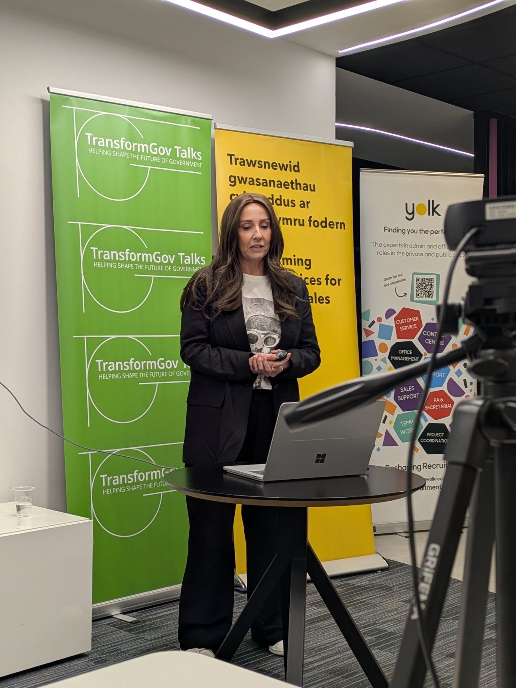
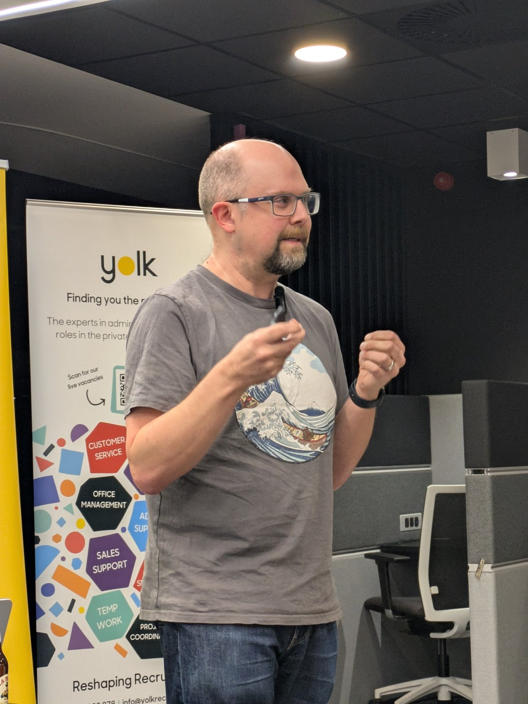
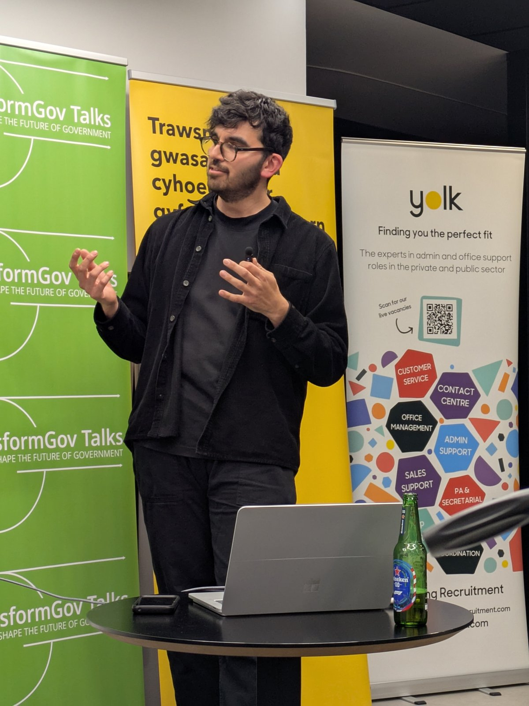

Title : TransformGov Talks Cymru : Our November 2026 Cardiff event!

Hi everyone,

Our latest Welsh event took place at Yolk Recruitment in Cardiff (and online!) on 18 November 2026.

Brought to you by our excellent sponsors GovCamp, dxw, TPXimpact, Ceva, Public.Digital, Holistic Agility, State of the Future and Agile.

Hosted by [Transform Wales](https://transform.wales/).

Our first speaker was Rachel Meese, Head of UCD at [Digital Health and Care Wales](https://dhcw.nhs.wales/), on building a user-centred design team in the Welsh public sector, and lessons from helping senior leaders recognise the value of user-centred design.

Our second speaker was Andy Regan, Head of [Nesta Cymru](https://www.nesta.org.uk/), on Nesta's work to shape policy in Wales and bring innovation into policymaking. **[TODO: his actual topic, from the Gemini notes]**

Our third speaker was Omar Idris, Head of Design at [Perago](https://perago.co.uk/), on how a test-and-learn approach helps teams quickly find what works, with less risk.

If you weren't able to attend, you can catch up on the event in more detail:

- Read the [Gemini AI Summary](TODO-gemini)
- [Video on YouTube](TODO-youtube)
- Listen on [Spotify](TODO-spotify) or [Apple Podcasts](TODO-apple)

At the end of the event, we included a few parish notices for other events and projects you might be interested in: **[TODO: confirm against tonight's notices]**

- [Policy Camp](https://policycamp.org.uk/) (report now published)
- [National Conversations](https://nationalconversations.org/)
- [Civic Punks](https://civicpunks.com/)
- [Data Bites](https://www.thinkdigitalpartners.com/data-bites/) (#63, 2 December)
- [The National Strategy Project](https://www.nationalstrategy.uk/)
- [Open Data Camp](https://www.odcamp.uk/) (21–22 November)

You can also [download this poster](https://drive.google.com/file/d/1ZkA37iPO9NbALvxvNBA431fVpAAMKtwP/view?usp=drive_link) to put up in your office. If you do — please share a photo with us!

Let us know if you have an event you'd like us to publicise.

Finally, our next events are both at the Ministry of Justice in London:

- 25 November 2026, 6-7pm, featuring Peter Thomas (civilservicereformuk.com) on what 15 years of GDS tell us about successful reform; Tom Wynne-Morgan and Jack Strachan (Government Digital Service) on 'Transforming Gov: from digital transactions to digital decisions'; and Beatriz Brown (Attorney General's Office) on public engagement on the rule of law. [You can register now!](https://luma.com/8oaszd9g)
- 9 December 2026, 6-7pm, speakers to be announced soon. [You can register now!](https://luma.com/4pwpi726)
